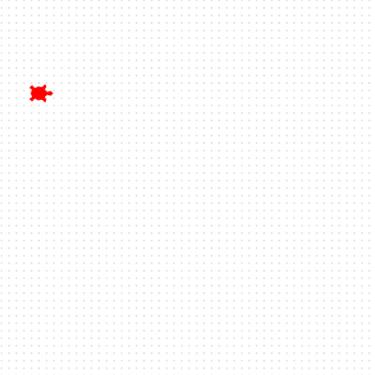

## Añade una tortuga

Crea tu primera tortuga de carreras y prepárala en la línea de salida.

**¡Saluda a Ada! 🐢**

Empieza por añadir una tortuga a la pantalla.

Puedes ponerle a la tortuga el nombre que quieras. Aquí le llama `ada`.

Esta tortuga adquiere un color y una forma, y luego se desplaza a su posición inicial en la pista.

```python filename="main.py" line_numbers="true" line_number_start="4" line_highlights="4-9"
ada = Tortuga()
ada.color('rojo')
ada.forma('tortuga')
ada.bajarlápiz()
ada.mover(-160, 100)
ada.bajarlápiz()
```

> [!CONSEJO]
>
> - Puedes cambiar el color de la tortuga al que quieras.
> - La función `mover` establece la posición `x` e `y` de la tortuga en la pantalla.

> [!DEPURAR]
>
> - Asegúrate de poner el color entre comillas: "rojo"

## Ejecuta tu código

Ejecuta tu código y comprueba que aparezca una tortuga del lado izquierdo de la pantalla.


